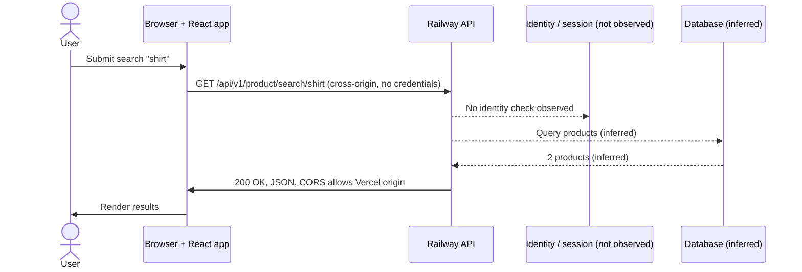

# Week 5 Learning Record — Following One Browser Action

**Application:** EliteMart (MERN e-commerce), frontend on Vercel, API on Railway. **Tool:** Edge Developer Tools, 24 October 2026. **Action:** searched for `shirt`.

## 1. Annotated request and response

```
GET /api/v1/product/search/shirt          <- method and path; the search term is in the path
:authority  mernecommerceapp-production-2c05.up.railway.app
Origin      https://mern-ecommerce-app-v2.vercel.app   <- different origin from the API, so CORS applies
Accept      application/json, text/plain, */*
Sec-Fetch-Site: cross-site, Sec-Fetch-Mode: cors       <- set by the browser
(no Cookie, no Authorization)                          <- no identity sent; endpoint appears public

200 OK                                                 <- HTTP outcome only, not proof of correct access control
Content-Type: application/json; charset=utf-8
Access-Control-Allow-Origin: https://mern-ecommerce-app-v2.vercel.app   <- lets that origin's scripts read the reply
Access-Control-Allow-Credentials: true, Vary: Origin
Strict-Transport-Security: max-age=31536000; includeSubDomains
ETag: W/"26746b-..."                                   <- enables later revalidation
{ "success": true, "count": 2, "products": [ ... ] }   <- includes base64 image data
```

**Triggered by:** `onSubmit` → `search` → `xhr` in `index-DxGZg1ZC.js` (Initiator tab).
**Repeat:** the browser sent `If-None-Match` with the same ETag and got `304 Not Modified`: data unchanged, caching confirmed. It took 8.38 s versus 3.53 s for the first request, so revalidation saved bandwidth but not time; the cause of the slowness is not established.

## 2. Diagram

Solid arrows are observed. Dashed arrows are inferred.



## 3. Two trust boundaries

**Browser → API (observed).** The search term, headers and any credentials cross from an untrusted client to the server over HTTPS. The browser cannot prove how the server validates the term or enforces authorisation; that needs source code or authorised testing. Controls seen: HTTPS with HSTS, a single-origin CORS allow-list. Remember that CORS limits what other websites can read, and does not authenticate anyone.

**API → database (inferred).** The query built from the search term goes in, and stored product data comes back and is later rendered in the browser. Controls to verify: safe query construction, a least-privilege database account, protected secrets, and output encoding where the frontend renders product text.

## 4. Observed vs inferred

| Observed in the browser | Needs server-side evidence |
| --- | --- |
| Method, URL, status, headers, JSON, timing, initiator, `304` revalidation | Input validation, database query, authorisation on protected routes, application logs, cause of the timing difference |

Full detail: `http-investigation.md`, `web-architecture.md`, `sequence-diagram.md`, `discussion-prompts.md`.