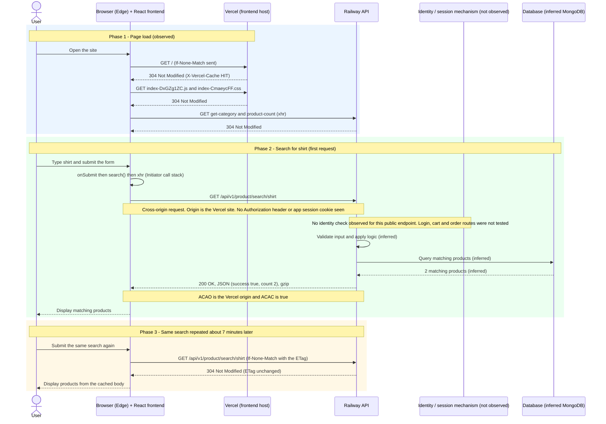

# HTTP Request–Response Sequence Diagram

## 1. Objective

This document shows the order of communication for one ordinary browser action in EliteMart: **searching for "shirt"**. Every browser-to-server step uses values recorded in Microsoft Edge Developer Tools. Steps inside the server are marked as inferred.

## 2. Investigated Action

| Item | Observation |
| --- | --- |
| Application | EliteMart (MERN e-commerce application) |
| Frontend origin | `https://mern-ecommerce-app-v2.vercel.app` |
| API origin | `https://mernecommerceapp-production-2c05.up.railway.app` |
| Browser action | Typed `shirt` into the search form and submitted it |
| Request | `GET /api/v1/product/search/shirt` |
| Request type | `xhr` (Fetch/XHR filter) |
| First response | `200 OK`, `Content-Type: application/json; charset=utf-8`, `Content-Encoding: gzip` |
| Repeated response | `304 Not Modified` after the browser sent `If-None-Match`; same `ETag` |
| Response body | `{ success: true, count: 2, products: [...] }` |

## 3. Sequence Diagram — Page Load and Search

## 4. Observed vs Inferred Steps

### Directly observed (Developer Tools)

- The search was triggered by the frontend code path `onSubmit` → `search` → `request` → `xhr` in `index-DxGZg1ZC.js` (Initiator tab).
- Method `GET`, path `/api/v1/product/search/shirt`, scheme `https`, `Accept: application/json, text/plain, */*`.
- `Origin: https://mern-ecommerce-app-v2.vercel.app`, `Sec-Fetch-Mode: cors`, `Sec-Fetch-Site: cross-site`, `Sec-Fetch-Dest: empty`.
- First response `200 OK` (Date: Sat, 24 Oct 2026 08:14:53 GMT) with JSON and `ETag`.
- Repeated request carried `If-None-Match` with the first response's `ETag`; the response was `304 Not Modified` (Date: 08:21:58 GMT) with an identical `ETag`.
- Neither request carried a `Cookie` or `Authorization` header.
- Response JSON: `success: true`, `count: 2`, a `products` array whose first item is "Crew Neck T-Shirt" with an embedded base64 PNG.
- Timing, first request (`200`): Queueing 0.96 ms, Stalled 1.86 ms, Request sent 0.34 ms, Waiting 2.57 s, Content download 958.14 ms, total 3.53 s.
- Timing, repeated request (`304`): Queueing 1.28 ms, Stalled 29.96 ms, Request sent 0.72 ms, Waiting 2.74 s, Content download 5.60 s, total 8.38 s.

### Inferred unless verified separately

- The API validates or sanitises the search term.
- The API queries a database (likely MongoDB) and filters products by name or description.
- The `304` is produced by the server comparing the `ETag` / `If-None-Match` values.
- The HTTP client library is Axios.

## 5. Security Considerations

- **Input validation:** the search term travels in the URL path, so the server must validate and safely handle it (including special characters and very long values). The browser cannot show whether this happens.
- **Authentication and authorization:** no credentials were visible on this request, so the endpoint appears to be public. That is reasonable for a product catalogue, but it means authorization was not exercised by this test.
- **CORS:** the API allows one specific origin and sends `Vary: Origin`. CORS does not replace server-side checks; it only controls which sites' scripts can read the response.
- **Data exposure:** the response includes internal identifiers (`_id`, `category`) and embedded image data. These are not secrets in a public catalogue; the payload is probably large because of the base64 images, but its size was not measured.
- **Transport:** HTTPS with `Strict-Transport-Security: max-age=31536000; includeSubDomains`.

## 6. Limitations

- Developer Tools shows what the client sent and received. Database activity, internal validation and authorization logic were not observed.
- The two requests were captured in separate page loads, so their timings (3.53 s and 8.38 s) are not a controlled comparison, and the `200` response's Size was not captured.
- Only one request path was investigated; other endpoints (login, cart, orders) were not tested.

## 7. Conclusion

The sequence confirms a clean client-visible flow: a form submit in the React frontend produces one cross-origin `GET` to the API, which returns JSON. A repeat of the same request sent `If-None-Match` and received `304 Not Modified` with an unchanged `ETag`, which is HTTP conditional revalidation (and, notably, was slower rather than faster). Everything behind the API response remains inferred until supported by source code or server logs.