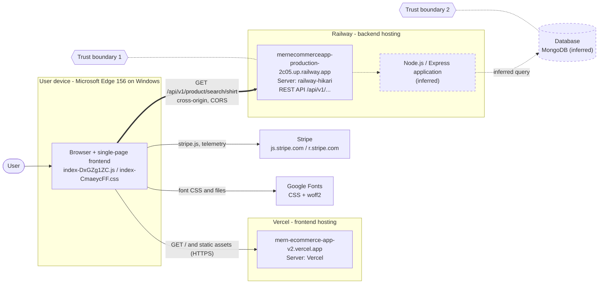

# Web Application Architecture — EliteMart

## 1. Objective

This document maps the architecture of the investigated application (EliteMart, a MERN e-commerce site), shows how data flows between components, identifies trust boundaries, and separates what I **directly observed** in Microsoft Edge Developer Tools from what I **inferred**.

## 2. Architecture Diagram

Solid arrows are communications observed in the Network panel. Dashed arrows and dashed boxes are inferred and have not been verified with source code, logs or server-side evidence.

**Diagram notes**

- The frontend and API are on **different origins** (`mern-ecommerce-app-v2.vercel.app` vs `mernecommerceapp-production-2c05.up.railway.app`), so API calls are cross-origin and depend on CORS.
- All captured requests used `https`. The request headers appear as `:authority`, `:method`, `:path` and `:scheme`, which is how HTTP/2 requests are displayed.
- The thick arrow is the request investigated in this report.

## 3. Components

### 3.1 Browser and frontend — observed

- The page `https://mern-ecommerce-app-v2.vercel.app/` returned an HTML document, then loaded a JavaScript bundle (`index-DxGZg1ZC.js`), a stylesheet (`index-CmaeycFF.css`), images (logo and category banners) and fonts.
- The Initiator call stack for the search request shows `onSubmit` → `search` → `request` → `xhr` inside `index-DxGZg1ZC.js`. The search form handler therefore triggered the API call.
- The Network panel shows the API calls with type `xhr`. The `request` / `_request` / `xhr` call-stack names suggest an HTTP client library such as Axios (**inferred**, not confirmed).
- Browser identified as Microsoft Edge 156 on Windows (`Sec-Ch-Ua`, `User-Agent`).

Security considerations:

- Anything delivered to the browser (JavaScript, JSON, request parameters) is visible to the user and cannot be treated as secret.
- Client-side validation or hidden UI elements are not security controls; requests can be sent without the UI.

### 3.2 Frontend hosting — observed (Vercel)

- Response headers on the document: `Server: Vercel`, `X-Vercel-Cache: HIT`, `X-Vercel-Id`, `Cache-Control: public, max-age=0, must-revalidate`, and an `ETag`.
- The browser sent `If-None-Match` and `If-Modified-Since`, and the server answered `304 Not Modified`.

### 3.3 API server — observed headers, inferred internals (Railway)

- Endpoint pattern `/api/v1/product/search/<term>` with `Server: railway-hikari`, `X-Railway-Edge: sin1` and `X-Railway-Request-Id`, indicating the request passed through Railway's edge/proxy layer (observed).
- The response included a set of security headers (HSTS, `X-Content-Type-Options`, `X-Frame-Options`, `Cross-Origin-Opener-Policy`, `Cross-Origin-Resource-Policy`, `Referrer-Policy`, and others). This combination resembles the defaults of the Express "helmet" middleware (**inferred**).
- That the application behind it is Node.js/Express is **inferred** from the MERN stack naming and header pattern; the browser did not prove it.

Security considerations:

- The server must independently validate the search term and enforce authorization; CORS only controls which sites' scripts can read responses.

### 3.4 Database — inferred only

- The JSON response contains `_id`, `__v`, `createdAt` and `updatedAt` fields, which is the typical shape of MongoDB documents created through Mongoose (**inferred**).
- No browser evidence shows the database query itself.
- Product images are returned inside the JSON as base64 data (`"contentType": "image/png"`, `"url": ""`, `"public_id": ""`), which suggests the image bytes are stored with the product record rather than served from an image host (**inferred**).

### 3.5 Third-party services — observed

| Service | Evidence | Purpose (inferred where noted) |
| --- | --- | --- |
| Stripe (`js.stripe.com`, `r.stripe.com`) | `stripe.js`, `controller-with-preconnect-*.html`, `shared-e-*.js`, `r.stripe.com/b` requests | Payment and fraud/telemetry scripts (inferred purpose) |
| Google Fonts | `css2?family=Playfair+Display...&family=DM+Sans...` stylesheet and `.woff2` fonts | Page typography |

The Stripe cookies `__stripe_mid` and `__stripe_sid` were present in the document request's `Cookie` header (values redacted in this report).

## 4. Trust Boundaries

### Trust boundary 1 — Browser → API (observed crossing)

- **Crossing:** `GET /api/v1/product/search/shirt` over HTTPS, cross-origin (`Origin: https://mern-ecommerce-app-v2.vercel.app`, `Sec-Fetch-Site: cross-site`, `Sec-Fetch-Mode: cors`).
- **Data crossing:** the search term (in the URL path), request headers (`Accept`, `Origin`, `Referer`, `Accept-Language`) and any credentials. No `Authorization` header or application session cookie was visible in the captured request headers.
- **Potential risks (general, not confirmed here):** unexpected or malformed search input, injection through user-controlled path values, excessive request volume, and over-permissive CORS configuration.
- **Controls observed:** HTTPS with HSTS (`max-age=31536000; includeSubDomains`); CORS allow-list returning a single specific origin plus `Vary: Origin`.
- **Controls to verify with source code:** server-side validation/sanitisation of the search term, rate limiting, logging, and error handling.

### Trust boundary 2 — Application server → Database (inferred)

- **Crossing:** the search query and the returned product documents.
- **Potential risks (general):** unsafe query construction (for example NoSQL or regular-expression injection when a user value is used in a query), over-privileged database account, exposed connection credentials.
- **Controls to verify:** parameterised or sanitised queries, least-privilege database user, secrets kept in environment variables, network restrictions.

### Additional boundary — Browser → third-party scripts (observed)

The page loads and executes code from `js.stripe.com`. Third-party script origins are trusted to run in the user's browser, so a Content-Security-Policy and subresource controls are relevant on the frontend (not yet verified on a full `200` response of the frontend document).

## 5. Where Controls Belong

| Control | Where it belongs | Evidence for EliteMart |
| --- | --- | --- |
| Input validation | API server, at the browser → API boundary, for every request (the search term arrives in the URL path) | Not observable from the browser; needs source code or authorised testing |
| Authentication | API server (session lookup or token verification) | No credentials sent on search; not exercised |
| Authorisation | API server, per endpoint and per resource, never in the UI | Not exercised; a hidden or disabled button is not a control because the API is a separate public origin that can be called directly |
| Logging | API server and hosting proxy | Railway adds `X-Railway-Request-Id` and `X-Hikari-Trace`, so the platform tracks requests; application logs not seen |
| Output encoding | Wherever data is rendered into HTML: the frontend when it displays product `name` and `description`, which come from the database | Not observable. React escapes text it renders by default (inferred from the stack); raw HTML insertion would need checking in source |
| Query safety | API → database boundary (parameterised or sanitised queries) | Not observable |

Data crosses the second boundary twice: the query goes in, and stored content comes back out and is later rendered in the browser. That return path is why output encoding matters even when input validation exists.

## 6. Observation vs Inference

| Item | Classification | Evidence |
| --- | --- | --- |
| Browser sends `GET` to `/api/v1/product/search/shirt` | Observed | Headers tab |
| API responds `200 OK` with `application/json; charset=utf-8` | Observed | Headers tab |
| Frontend and API are on different origins | Observed | URLs, `Origin`, `Sec-Fetch-Site: cross-site` |
| CORS allows the Vercel origin with credentials | Observed | `Access-Control-Allow-Origin`, `Access-Control-Allow-Credentials: true` |
| Search was triggered by the form's `onSubmit` handler | Observed | Initiator call stack |
| Frontend hosted on Vercel, API on Railway | Observed | `Server` headers, domains |
| Express/Node.js runs the API | Inferred | MERN stack, header pattern |
| MongoDB executes a query for each search | Inferred | `_id`/`__v` fields; no server evidence |
| Server validates the search term | Not established | Needs source code or authorised testing |
| Server enforces authorization on this endpoint | Not established | No credentials observed; endpoint appears public |

## 7. Conclusion

EliteMart uses a split architecture: a static single-page frontend on Vercel calling a REST API on Railway across origins, with Stripe and Google Fonts as third-party dependencies. The browser evidence confirms the first two boundaries' client-visible side, while the application server's internal logic and the database remain inferred until verified with source code or logs.