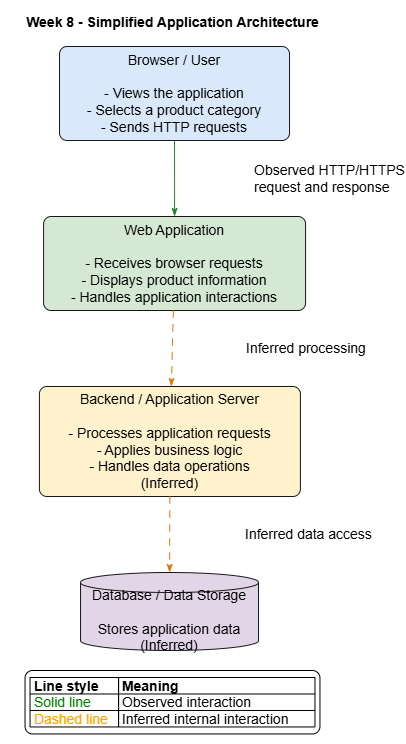

# Week 8 — Architecture and Scope

## 1. Application Details

- **Application:** PortSwigger Web Security Academy
- **Lab:** SQL injection vulnerability in WHERE clause allowing retrieval of hidden data
- **Environment:** Authorised online training environment
- **Main feature:** Product-category filtering
- **Testing tool:** Burp Suite Community Edition
- **Browser:** Burp built-in browser
- **Operating system:** Windows
- **Review date:** 14 November 2026

## 2. Testing Scope

This security review is restricted to my individual PortSwigger Web Security Academy training lab.

The investigation focuses on the product-category filtering feature and its HTTP request and response behaviour.

## 3. Included Activities

- Observing normal application behaviour.
- Capturing HTTP requests using Burp Suite.
- Inspecting request parameters and response information.
- Performing controlled tests permitted by the training lab.
- Analysing possible security weaknesses.
- Recommending secure engineering solutions.

## 4. Excluded Activities

- Testing unrelated websites.
- Testing third-party systems.
- Accessing real users' private information.
- Testing unauthorised accounts.
- Performing destructive or uncontrolled automated testing.

## 5. Tools

- Burp Suite Community Edition
- Burp built-in browser
- PortSwigger Web Security Academy

## 6. Application Architecture

The diagram below presents a simplified view of the application's
request flow.

**Evidence notes:**
- The browser-to-web-application interaction was observed during the
  normal browsing investigation.
- Backend processing and database interactions are inferred.
- The internal implementation was not independently verified.

## 7. Limitations

This review is based on observations from the authorised training environment.

The internal source code, database implementation, and complete server configuration are not necessarily visible. Conclusions about these components will be identified as assumptions or inferences unless supported by evidence.